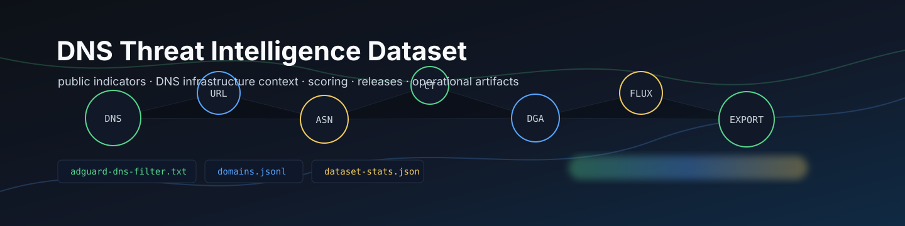

_English version: [README.md](README.md)_

<p align="center">
  
</p>

# DNS-Threat-Intelligence-dataset

DNS-Threat-Intelligence-dataset — это open-source-конвейер DNS-аналитики угроз (threat intelligence) для сбора публичных индикаторов, их нормализации в типизированные записи, обогащения контекстом инфраструктуры, оценки свидетельств (evidence) и публикации эксплуатационных артефактов для DNS-фильтрации, загрузки в SIEM, аналитики и исследовательских процессов.

<p align="center">
  <a href="https://github.com/ipanalytics/DNS-Threat-Intelligence-dataset/actions/workflows/test.yml">
    
  </a>
  <a href="https://github.com/ipanalytics/DNS-Threat-Intelligence-dataset/actions/workflows/pages.yml">
    
  </a>
  <a href="https://github.com/ipanalytics/DNS-Threat-Intelligence-dataset/releases">
    
  </a>
  
  
  
</p>

<p align="center">
  <a href="https://ipanalytics.github.io/DNS-Threat-Intelligence-dataset/">Dashboard</a>
  ·
  <a href="https://github.com/ipanalytics/DNS-Threat-Intelligence-dataset/releases">Releases</a>
  ·
  <a href="./docs/output-schemas.md">Schemas</a>
  ·
  <a href="./docs/adapter-authoring.md">Adapter authoring</a>
  ·
  <a href="./docs/active-dns-safety.md">DNS safety</a>
</p>

---

## Обзор

Проект преобразует публичные фиды DNS- и security-аналитики угроз в воспроизводимый
набор данных с атрибуцией источников и эксплуатационными артефактами. Адаптеры
собирают публичные индикаторы URL, доменов и IP, слой нормализации приводит домены,
URL и IP к каноническому виду, а экспортеры публикуют списки блокировки, JSONL, CSV,
отчёты, данные дашборда и ресурсы GitHub Release.

Эксплуатационные сценарии выполняют сбор из действующих публичных фидов, не
требующих учётных данных. Режим фикстур сохранён для тестов, локальных smoke-проверок
и разработки адаптеров; выходные данные фикстур не предназначены для представления
охвата threat intelligence.

---

## Поведение системы

```text
public feeds
        |
        v
source adapters -> Evidence[]
        |
        v
normalization -> domains / URLs / IPs
        |
        v
scoring -> confidence / reason codes / recommended action
        |
        v
artifacts -> DNS lists / JSONL / CSV / reports / dashboard / releases
```

Конвейер спроектирован вокруг явных свидетельств (evidence), а не непрозрачного
включения в списки блокировки. Каждый индикатор может содержать метаданные
источника, метки категорий, отметки времени, оценку достоверности (confidence)
и рекомендуемое действие.

---

## Возможности

| Область | Возможность |
|---|---|
| Приём фидов | URLhaus, ThreatFox, FeodoTracker, OpenPhish, public-dns.info, trickest/resolvers |
| Нормализация | Разбор URL, извлечение доменов, обработка IDN/punycode, аппроксимация eTLD+1, валидация IP, поддержка defang/refang |
| Учёт по источникам | Статистика по свидетельствам, доменам, URL, IP, статусам и причинам пропуска для каждого источника |
| Публикация | Простые DNS-списки, фильтр AdGuard DNS, JSONL, CSV, отчёты Markdown, JSON дашборда, GitHub Releases |
| Автоматизация | CI, сборка набора данных по расписанию, развёртывание GitHub Pages, релизный workflow с приложенными артефактами |

---

## Статистика набора данных

<!-- DNSINTEL_STATS_START -->
_Сгенерировано: `2026-06-19T14:41:56.204588+00:00`_

| Метрика набора данных | Количество |
|---|---:|
| Вредоносные домены | 1607 |
| Фишинговые домены | 0 |
| Домены с вредоносным ПО | 1607 |
| Домены C2 | 1118 |
| Вредоносные IP | 1705 |
| IP C2 | 1705 |
| Открытые резолверы | 62790 |
| Вредоносные URL | 4024 |
| Правила AdGuard DNS | 3911 |
| Нормализованные записи доменов | 1607 |
| Нормализованные записи URL | 4029 |
| Обогащённые файлы | 1 |
| Отчёты | 2 |
<!-- DNSINTEL_STATS_END -->

Блок статистики управляется скриптом `scripts/update_stats.py` и обновляется
workflow-процессами сборки набора данных и релизов.

---

## Быстрый старт

```bash
git clone https://github.com/ipanalytics/DNS-Threat-Intelligence-dataset.git
cd DNS-Threat-Intelligence-dataset

uv sync --all-groups
uv run python -m dnsintel.cli config validate
uv run python scripts/update_feeds.py --live --output data
uv run python scripts/update_stats.py --data-dir data --readme README.md
uv run python -m dnsintel.cli dashboard build --data-dir data --output docs/dashboard
```

Запустите набор верификационных проверок:

```bash
uv run ruff format --check .
uv run ruff check .
uv run pytest
uv run python -m compileall dnsintel scripts
```

---

## Установка

Проект использует [`uv`](https://github.com/astral-sh/uv) для управления
зависимостями.

```bash
uv sync --all-groups
```

Для локального использования CLI без установки через console-script:

```bash
uv run python -m dnsintel.cli --help
uv run python -m dnsintel.cli config validate
```

---

## Примеры использования

Сбор из актуальных (live) публичных фидов:

```bash
uv run python scripts/update_feeds.py --live --output data
```

Генерация небольшого снапшота для разработки на основе фикстур:

```bash
uv run python scripts/update_feeds.py --sample --output data
```

Повторная генерация производных файлов списков:

```bash
uv run python scripts/generate_lists.py --input data --output data
```

Обновление статистики README/дашборда:

```bash
uv run python scripts/update_stats.py --data-dir data --readme README.md
```

Локальная сборка релизных артефактов:

```bash
uv run python scripts/build_release_assets.py --data-dir data --output dist/release
```

Сборка статического дашборда:

```bash
uv run python -m dnsintel.cli dashboard build \
  --data-dir data \
  --output docs/dashboard
```

---

## Результаты и артефакты

| Путь | Назначение |
|---|---|
| `data/lists/malicious-domains.txt` | Простой блоклист доменов |
| `data/lists/phishing-domains.txt` | Список фишинговых доменов |
| `data/lists/malware-domains.txt` | Список доменов, связанных с вредоносным ПО |
| `data/lists/c2-domains.txt` | Список доменов C2 |
| `data/lists/malicious-ips.txt` | Публичный список вредоносных IP из источников, ориентированных на IP |
| `data/lists/c2-ips.txt` | Список IP C2 |
| `data/lists/open-resolvers.txt` | Список публичных DNS-резолверов |
| `data/lists/malicious-urls.txt` | Список вредоносных URL |
| `data/lists/adguard-dns-filter.txt` | Правила фильтра AdGuard DNS |
| `data/normalized/domains.jsonl` | Нормализованные доменные индикаторы |
| `data/normalized/urls.jsonl` | Нормализованные URL-индикаторы |
| `data/enriched/source-summary.csv` | Статистика сбора на уровне источников |
| `data/enriched/*.csv` | Сводка по источникам и таблицы включённого обогащения |
| `data/reports/*.md` | Отчёты об обновлениях и рисках в человекочитаемом виде |
| `data/dashboard/*.json` | Метрики дашборда и статистика набора данных |
| `docs/dashboard/index.html` | Статический дашборд, публикуемый через GitHub Pages |
| `dist/release/*` | Локально сгенерированные релизные пакеты |

Каждый релиз набора данных включает `adguard-dns-filter.txt`, текстовые списки, нормализованные JSONL-записи, статистику набора данных и zip-архивы списков/обогащения.

---

## Формат данных

Основные записи представлены моделями Pydantic в `dnsintel.models`.

### Доменный индикатор

```json
{
  "domain": "c2-control.evil",
  "etld1": "c2-control.evil",
  "category": ["c2", "malware"],
  "sources": ["threatfox"],
  "confidence": "critical",
  "score": 95.0,
  "recommended_action": "block_domain",
  "evidence": [
    {
      "source_name": "threatfox",
      "indicator_type": "domain",
      "value": "c2-control.evil",
      "category": ["c2", "malware"],
      "confidence": 95.0
    }
  ]
}
```

### Рекомендуемые действия

| Действие | Значение |
|---|---|
| `monitor` | Отслеживать индикатор; недостаточно уверенности для блокировки |
| `block_domain` | Подходит для рабочих процессов блокировки DNS/доменов |
| `block_url` | Предпочтительна блокировка на уровне URL |
| `block_ip` | Действие на уровне IP допустимо для данного контекста улик |
| `do_not_block_shared_infra` | Индикатор находится на общей инфраструктуре; избегать широкой блокировки IP/ASN |
| `needs_review` | Слабый или контекстный сигнал, требующий проверки аналитиком |

---

## Эксплуатационные замечания

- Live-интеграции следует включать для каждого источника в `configs/sources.yml`.
- CI использует детерминированные тесты; воркфлоу набора данных, Pages и релиза
  по умолчанию используют актуальные публичные фиды.
- Стандартные live-сборки публикуют только артефакты, подкреплённые включёнными
  в текущий момент публичными фидами.
- Установите `ABUSECH_AUTH_KEY` как секрет GitHub Actions, чтобы ThreatFox
  использовал аутентифицированный путь API abuse.ch; публичные экспорты
  остаются резервным вариантом.
- Источники с ограничением по регистрации исключены из стандартных запусков,
  пока не настроены учётные данные и специфичные для источника условия
  использования.

---

## GitHub Actions

| Воркфлоу | Триггер | Назначение |
|---|---|---|
| `test` | push, pull request | Ruff, pytest, проверки компиляции |
| `build-dataset-artifacts` | вручную, по расписанию | Пересборка артефактов данных и загрузка артефакта воркфлоу |
| `pages` | push в `main`, вручную | Сборка и развёртывание статического дашборда |
| `dataset-release` | вручную, по расписанию | Сборка релизных артефактов набора данных и создание GitHub Release |

Чтобы опубликовать новый релиз набора данных:

```bash
gh workflow run dataset-release -f tag=dataset-YYYYMMDD
```

Если `tag` опущен, воркфлоу создаёт тег набора данных с меткой времени UTC.

---

## Развёртывание

GitHub Pages развёртывается воркфлоу `pages` с использованием сгенерированного
каталога `docs/dashboard`.

Необходимые настройки репозитория:

| Настройка | Значение |
|---|---|
| Источник Pages | GitHub Actions |
| Ветка по умолчанию | `main` |
| Права Actions | Чтение/запись для релизного воркфлоу |

Live-дашборд доступен по адресу:

```text
https://ipanalytics.github.io/DNS-Threat-Intelligence-dataset/
```

---

## Область применения проекта

Этот репозиторий предназначен для:

- Конвейеры DNS-фильтрации и политик резолверов
- Рабочие процессы обогащения в SOC/SIEM
- Исследования в области киберразведки (threat intelligence)
- Отчётность abuse-служб и по рискам инфраструктуры
- Анализ индикаторов мошенничества/рисков
- Инженерия данных поверх публичных фидов безопасности

Проект ориентирован на публичную, атрибутируемую и воспроизводимую разведывательную
информацию. Адаптеры источников спроектированы так, чтобы происхождение (provenance)
и уровень доверия (confidence) были видны уже на этапе приёма данных, а не скрывались
в итоговых списках блокировки.

---

## Структура каталогов

```text
.
├── configs/              # source, scoring, allowlist, and brand configuration
├── data/                 # generated lists, normalized records, enrichment, reports
├── dnsintel/             # Python package
│   ├── sources/          # source adapters
│   ├── normalize/        # domain, URL, IP normalization
│   ├── dns/              # optional DNS resolver utilities
│   ├── enrich/           # optional enrichment utilities
│   ├── ct/               # optional certificate transparency utilities
│   ├── dga/              # optional lexical DGA scoring
│   ├── flux/             # optional fast-flux scoring utilities
│   ├── osint/            # optional public-code/report IOC extraction
│   ├── scoring/          # confidence and action recommendation logic
│   ├── storage/          # JSONL, CSV, DuckDB, Parquet helpers
│   └── dashboard/        # static dashboard generator
├── docs/                 # operational docs and generated dashboard
├── scripts/              # dataset, stats, and release asset commands
└── tests/                # fixture-backed test suite
```

<details>
<summary>Команды для мейнтейнера</summary>

```bash
# rebuild sample data and dashboard
uv run python scripts/update_feeds.py --sample --output data
uv run python scripts/update_stats.py --data-dir data --readme README.md
uv run python -m dnsintel.cli dashboard build --data-dir data --output docs/dashboard

# build local release payloads
uv run python scripts/build_release_assets.py --data-dir data --output dist/release

# run checks
uv run ruff format --check .
uv run ruff check .
uv run pytest
uv run python -m compileall dnsintel scripts
```

</details>

---

## Ограничения

- Включённый в репозиторий набор данных генерируется из публичных оперативных
  фидов, доступных на момент сборки; режим фикстур зарезервирован для тестов
  и локальной разработки адаптеров.
- Некоторые коммерческие источники или источники, требующие регистрации,
  представлены в виде отключённых адаптеров или необязательных точек интеграции.
- Схемы публичных фидов могут меняться; адаптеры следует тестировать на фикстурах
  и проверять перед включением приёма данных в production.

---

## Лицензия

MIT. См. [LICENSE](./LICENSE).

---

## Отказ от ответственности

Этот проект публикует артефакты защитной DNS-разведки, полученные из публичных
или авторизованных пользователем источников. Операторы несут ответственность за
проверку условий использования источников, настройку политики в отношении ложных
срабатываний и анализ решений о блокировке до их применения в production.
